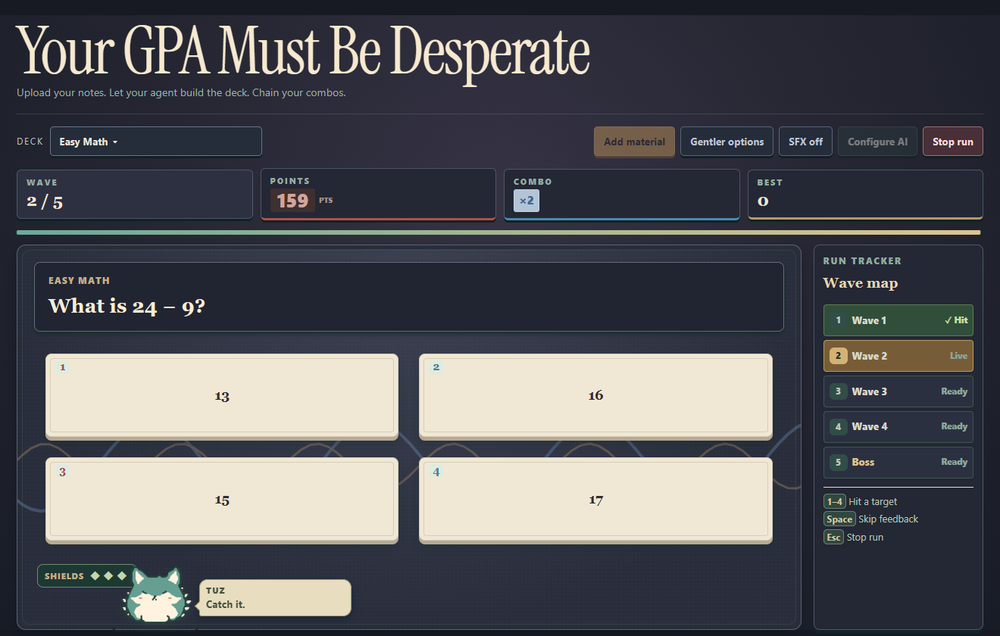
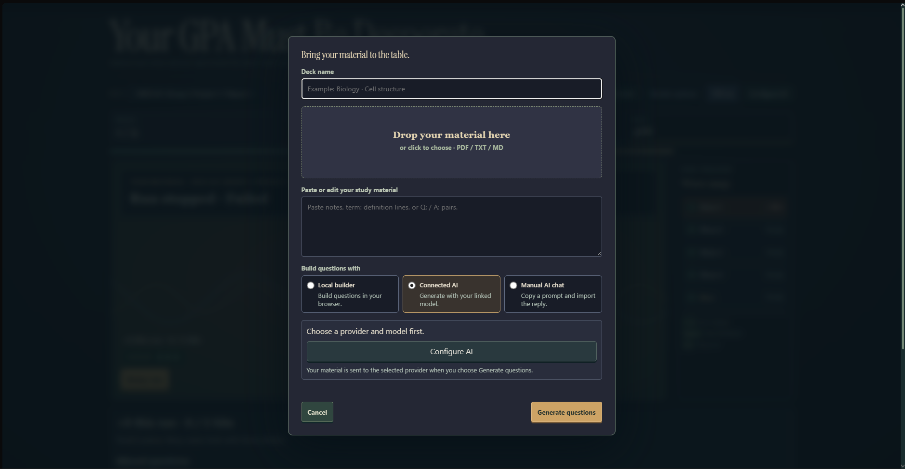
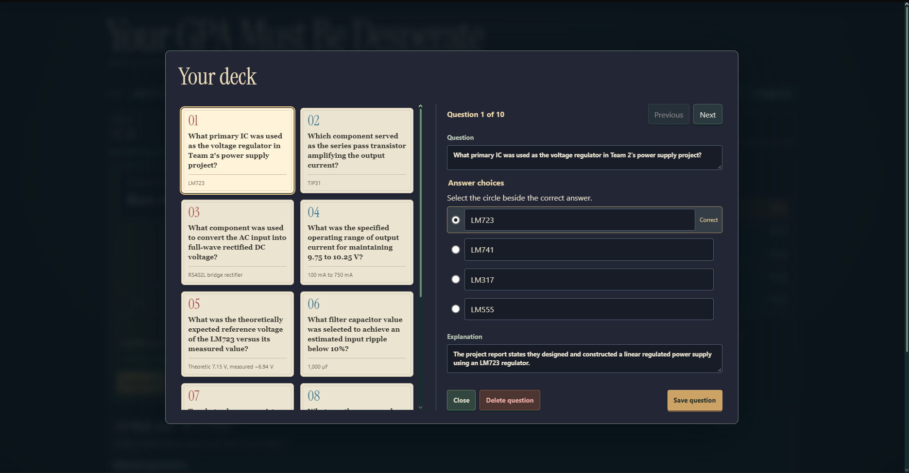

# Your GPA Must Be Desperate

**All-locally stored · AI compile material · Open source**

A browser quiz game that turns your notes into timed runs. Answer quickly, build a combo, and reach the boss wave before you lose all three shields. Try it out at https://minhhoag.github.io/desperate-gpa/

## Play in your browser

Download or clone this repository, then open `index.html` in your browser. Pick **Easy Math**, **Everyday Science**, **English Essentials**, or **World Geography**, and select **Start run**.

| Key | Action |
| --- | --- |
| **1–4** | Pick an answer |
| **Space** | Continue after feedback |
| **Esc** | Stop the run and review missed questions |
| **R** | Start or retry from the ready screen or results |

## Turn your notes into a deck

Select **Add material** and upload a text-based PDF, TXT, or Markdown file, or paste your notes. Choose how to build the questions.

- **Local builder** makes questions in your browser without an API key.
- **Connected AI** sends your material to the model you select in **Configure AI**. Browser connections require an endpoint that allows browser requests (CORS).
- **Manual AI chat** gives you a prompt to copy into an AI chat. Paste its JSON reply back into the game to import the deck.

## Share a study pack

Send your friends the ZIP file. They can open the game, choose **Add material → Import a study pack**, and select the file. The deck picker groups the imported modules by chapter. Questions with variants can change between runs, and **Open source** in missed question review opens the included PDF to the referenced page.

ZIP imports work from `index.html`. To import a 7z, RAR, TAR, or compressed TAR archive, run `npm start` and open the game from the local server. Keep the same folder structure when repacking. Each pack has a top-level folder containing `manifest.json`, `deck/` for the chapter modules, and `material/` for the source PDFs.

Study packs include their source PDFs. Share packs privately when they contain course materials, and check that you have permission to share the files.

## Edit your deck

Use **Edit deck** to revise questions, answer choices, and explanations before playing. The game stores decks, scores, and connection settings in your browser. API keys stay in memory until you reload or close the tab.

## Third-party assets

The `vendor/` folder includes PDF.js, GSAP, and Instrument Serif. The PDF.js and font licenses are included alongside the files. GSAP’s notice is in its bundle. [GSAP license](https://gsap.com/standard-license/)

The local archive importer bundles libarchive.js 2.0.2 with its license. The bundled JavaScript rejects unsafe archive path components.
